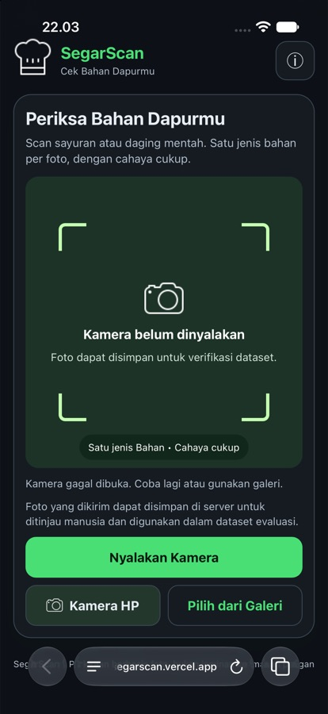
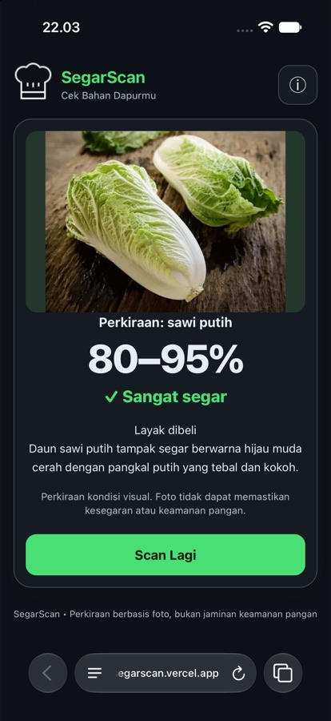
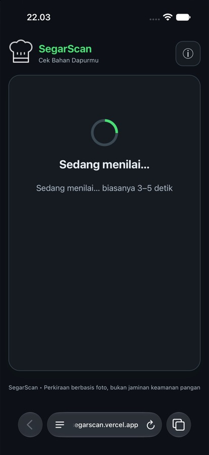
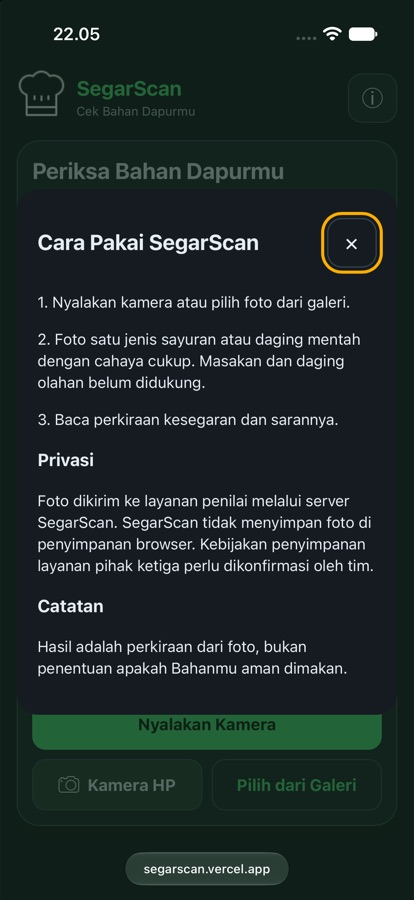
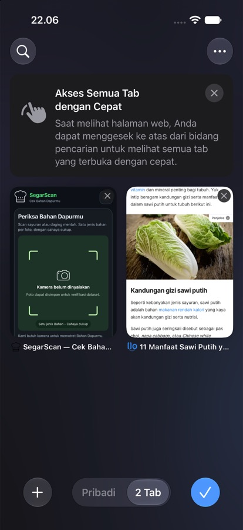

# SegarScan — Cek Bahan Dapurmu

SegarScan menilai kondisi visual **sayuran dan daging mentah** dari foto. Backend FastAPI menggunakan Gemini untuk penilaian visual, sedangkan model ML lokal memberikan prediksi jenis bahan sebagai pembanding eksperimental. Frontend kamera dan unggah foto disajikan oleh backend yang sama.

Foto yang diproses disimpan ke antrean **pending** untuk ditinjau manusia. Setelah verifikasi, foto dapat digunakan untuk melatih ulang model jenis lokal. Penambahan atau verifikasi foto tidak otomatis melatih model.

## Cakupan penilaian

- Satu jenis bahan per foto; boleh beberapa buah, ikat, atau potongan dari jenis yang sama.
- Mendukung sayuran serta daging mentah seperti ayam, sapi, kambing, dan babi. Masakan dan daging olahan belum didukung.
- Prompt aktif **p4** memeriksa tanda pembusukan sebelum memberi skor. Kerusakan pada sebagian objek tidak boleh tertutupi oleh bagian lain yang tampak segar.
- Jika model melaporkan pembusukan jelas, backend membatasi skor dan rentang ke 0–19 serta menampilkan **“Indikasi busuk”**. Jika meragukan, aplikasi meminta foto dekat tanpa memberi skor.
- Daging memakai label kondisi visual, bukan “layu”, “segera olah”, atau saran “layak dibeli”.

Skor 0–100 adalah perkiraan visual dan aturan kategori aplikasi, bukan persentase keamanan pangan. Akurasi pengenalan jenis dan pembusukan pada foto lapangan belum divalidasi. Bagian bahan yang tertutup tidak dapat dinilai dari foto.

## Tampilan aplikasi — dark theme

Berikut tampilan SegarScan pada iPhone, termasuk layar scan, proses penilaian, hasil, dan dialog informasi.

<table>
  <tr>
    <td align="center"><strong>Halaman scan</strong><br></td>
    <td align="center"><strong>Hasil penilaian</strong><br></td>
  </tr>
  <tr>
    <td align="center"><strong>Proses penilaian</strong><br></td>
    <td align="center"><strong>Dialog informasi</strong><br></td>
  </tr>
  <tr>
    <td colspan="2" align="center"><strong>Pratinjau tab Safari</strong><br></td>
  </tr>
</table>

## Menjalankan lokal

Jalankan dari root proyek. Alur penyimpanan dataset menggunakan `fcntl`, sehingga saat ini memerlukan macOS/Linux; Windows native belum didukung (gunakan lingkungan Linux seperti WSL).

```bash
python3 -m venv .venv
source .venv/bin/activate
python -m pip install -r requirements-dev.txt
```

Buat `.env` di root proyek:

```dotenv
GEMINI_API_KEY=isi_kunci_sendiri
USE_VLM=1
# Isi model yang mendukung gambar dan tersedia untuk akunmu.
# GEMINI_MODEL=nama_model_utama,nama_model_cadangan
DATASET_CAPTURE=1
USE_LOCAL_JENIS=1
```

Periksa akses dan daftar model (perintah ini menghubungi Gemini), lalu mulai server:

```bash
python cek_gemini.py
python -m uvicorn backend.app.main:app --reload
```

| Alamat | Fungsi |
|---|---|
| [Halaman aplikasi](http://127.0.0.1:8000/ui/) | Kamera dan unggah foto |
| [Dokumentasi API](http://127.0.0.1:8000/docs) | Kontrak API interaktif |
| [Health](http://127.0.0.1:8000/health) | Kesiapan konfigurasi penilai |

`/` mengarah ke `/ui/`. Restart server setelah perubahan `.env`, dan refresh halaman setelah perubahan frontend. `--reload` digunakan untuk pengembangan. Kamera pada HP memerlukan konteks browser yang mengizinkan kamera, biasanya HTTPS, serta izin pengguna.

## Alur scan dan dataset

```text
Kamera / unggah foto → POST /predict
  → validasi ukuran, format, EXIF, dan jumlah piksel
  → pemeriksaan kualitas foto → penilaian Gemini
  → penyusunan skor, kategori, dan saran
  → prediksi jenis ML lokal sebagai pembanding jika hasil penilaian berhasil
  → hasil di frontend + penyimpanan foto dan metadata pending

Pending → verifikasi manusia → CSV terverifikasi
  → perintah training → model jenis lokal → pembanding pada scan berikutnya
```

Model Gemini dipanggil bertahap: model utama lebih dahulu, lalu cadangan ketika diperlukan, dengan pembatasan slot. Model lokal tidak menggantikan jenis atau skor Gemini dan bukan fallback kesegaran; scan tetap memerlukan Gemini.

## Dataset pending dan verifikasi

### Lokasi data

| Lokasi | Isi |
|---|---|
| `data/pending/<ID>.img` | Byte gambar yang diterima server; dapat dibuka dengan Pillow |
| `data/pending/<ID>.json` | Prediksi sementara, waktu, ID request, status `pending`/`verified`, dan label manusia setelah verifikasi |
| `scripts/dataset.csv` | Label manusia untuk training/evaluasi |
| `scripts/images/<ID>.img` | Foto yang telah dimasukkan ke dataset |

ID berdasarkan SHA-256 isi foto. Unggahan dengan byte identik tidak membuat duplikat dan mempertahankan prediksi pertama. Foto terverifikasi tetap disimpan di antrean sebagai riwayat agar unggahan ulang tidak menjadi pending lagi. Foto yang dikompresi ulang dapat memiliki ID berbeda.

Foto valid yang mencapai tahap penilaian disimpan, termasuk hasil ditolak dan kegagalan penilai. Request yang ditolak lebih awal—model belum siap, rate limit, gambar rusak, atau terlalu besar—tidak disimpan. Jika penyimpanan gagal, respons prediksi tetap dikembalikan dan kegagalan dicatat di log.

### Lihat dan verifikasi satu foto

```bash
python -m scripts.review_dataset list
python -m scripts.review_dataset verify ID_FOTO --jenis bayam --status ok --perangkat "Macbook" --split dev
```

Ganti `ID_FOTO` dengan ID lengkap dari daftar. Periksa gambar dan masukkan jenis sebenarnya dari pengamatan manusia, bukan sekadar menyalin prediksi Gemini.

**`--status ok` berarti foto dapat dinilai, bukan bahannya segar.** Foto wortel busuk yang jelas tetap dapat berstatus `ok`. `ditolak` digunakan untuk foto yang tidak layak dinilai. Label kondisi seperti `segar`, `layu`, atau `busuk` belum tersedia dalam verifikasi; dataset ini belum menjadi target training kesegaran.

### Verifikasi massal per jenis

Fitur admin tersedia lewat CLI; belum ada halaman admin web.

```bash
python -m scripts.review_dataset groups
python -m scripts.review_dataset list --jenis "daging ayam"
python -m scripts.review_dataset verify-group --jenis "daging ayam" --status ok --perangkat "Macbook" --split dev --dry-run
python -m scripts.review_dataset verify-group --jenis "daging ayam" --status ok --perangkat "Macbook" --split dev
```

Ganti jenis dengan nama kelompok seperti `daging sapi`, `bayam`, atau `wortel`. Kelompok berasal dari **prediksi sementara**, sehingga anggotanya perlu diperiksa sebelum disetujui. Kapital dan spasi dinormalisasi, tetapi `ayam` dan `daging ayam` tetap kelompok berbeda.

| Opsi | Fungsi |
|---|---|
| `--dry-run` | Menampilkan ID terpilih tanpa perubahan |
| `--exclude ID_FOTO` | Melewati satu foto; dapat diulang |
| `--label bayam` | Memberi label manusia berbeda dari nama kelompok prediksi |
| `--dataset /path/dataset.csv` | Menentukan dataset tujuan |

Status, perangkat, label, dan split berlaku untuk semua foto terpilih. Pisahkan batch bila metadata berbeda. Kelompok `unknown` ditinjau per foto. Foto yang sudah verified dilewati dan unggahan baru setelah proses dimulai tidak otomatis ikut diverifikasi.

Jika sebagian foto gagal, proses melanjutkan foto lainnya dan melaporkan ID berhasil/gagal; kode keluar menjadi 1. Verifikasi massal bukan transaksi seluruh kelompok. Perintah dapat diulang untuk sisa pending setelah masalah diperbaiki.

### Menambah atau mengoreksi dataset secara manual

```bash
python -m scripts.update_dataset --foto /path/bayam.jpg --jenis bayam --status ok --perangkat "Macbook" --split dev
```

CSV kosong diinisialisasi otomatis. Foto divalidasi, disalin, dan ditambahkan; foto identik memperbarui baris yang sama. Baris lama dan kolom tambahan dipertahankan. Untuk mengoreksi jenis foto yang sudah verified, gunakan foto `data/pending/ID_FOTO.img` pada perintah ini. **Koreksi melalui `update_dataset` hanya memperbarui CSV; label riwayat JSON tidak ikut berubah.** Perintah `verify` sendiri menolak foto yang sudah verified.

Kolom CSV: `filename`, `human_label`, `device_source`, `file`, `jenis_benar`, `split`. Gunakan label jenis konsisten seperti `daging ayam`. Split `dev` digunakan untuk latihan/pengembangan dan `test` untuk pengujian terpisah. Memindahkan split pada foto yang sama memperbarui baris, bukan menggandakannya.

## Training dan evaluasi ML lokal

Setelah satu batch verifikasi selesai atau label dikoreksi:

```bash
python -m scripts.train_jenis
```

Training membaca `scripts/dataset.csv`, menggunakan `jenis_benar` sebagai target dan hanya mengambil baris `human_label=ok`. Foto pending tidak dibaca. Minimal dua kelas diperlukan pada split `dev`.

| Berkas | Fungsi |
|---|---|
| `models/jenis.json` | Model klasifikasi jenis lokal |
| `models/jenis.report.json` | Jumlah per kelas, hasil prediksi test, dan akurasi test |

Model merupakan baseline nearest-neighbor dengan histogram warna, rata-rata warna spasial, dan tekstur tepi; dependensinya sudah tersedia di `requirements.txt`. Tidak diperlukan PyTorch atau `requirements-train.txt` untuk baseline ini. `ml/predict.py` dan `models/segarscan.pt` adalah eksperimen lama dan tidak digunakan oleh alur scan aktif.

Server memuat model ketika diperlukan dan memuat ulang saat berkas model berubah. Frontend menampilkan **“ML lokal (eksperimental)”**, jumlah foto latihan, dan pemberitahuan jika prediksi berbeda dari Gemini. Model hilang/rusak tidak menggagalkan scan. Training tidak berjalan otomatis saat verifikasi.

Batasan model:

- Kemiripan warna atau latar dapat menyesatkan; kelas di luar data latihan juga dipetakan ke kelas terdekat.
- Jarak hasil model bukan probabilitas atau tingkat keyakinan terkalibrasi.
- Split `test` tidak digunakan saat training. Jika kosong, `akurasi_test` bernilai `null`, bukan bukti akurasi tinggi.
- Duplikat byte ditolak, termasuk lintas split. Pisahkan foto objek/sesi yang sama secara manual meskipun byte berbeda agar tidak bocor ke test.
- Model mengenali jenis bahan, bukan kondisi kesegaran. Training kesegaran memerlukan label kondisi manusia dan model terpisah.

Laporan training yang tersedia saat pembaruan ini memuat **18 foto, 9 kelas, dan 0 foto test**. Gunakan laporan hasil retraining terbaru sebagai acuan; kemampuan generalisasi belum diketahui.

### Membandingkan prompt Gemini

```bash
python -m scripts.evaluasi_jenis --dataset scripts/dataset.csv --split test --model NAMA_MODEL --kandidat /path/prompt_kandidat.txt --output /path/laporan-baru
```

Siapkan berkas tambahan prompt kandidat dan folder output yang belum ada. Perintah ini menghubungi Gemini dan membandingkan identifikasi jenis baseline/kandidat pada foto berlabel. Evaluasi tidak melatih model lokal. Baris format lama tanpa split tidak masuk evaluasi jenis.

## Konfigurasi

Server membaca `.env` melalui `backend/app/main.py`. Untuk menjalankan CLI dataset dengan direktori khusus, gunakan `--pending-dir /path/pending` **sebelum** subcommand, atau ekspor `DATASET_PENDING_DIR` di shell; CLI review tidak otomatis memuat `.env`.

| Variabel | Default | Fungsi |
|---|---|---|
| `GEMINI_API_KEY` | Kosong | Kunci Gemini; simpan di backend |
| `USE_VLM` | `1` | Mengaktifkan penilai Gemini |
| `GEMINI_MODEL` | Lihat `_daftar_model()` di `vlm.py` | Nama model utama/cadangan; sesuaikan akses akun |
| `DATASET_CAPTURE` | `1` | Penyimpanan otomatis pending; `0` menonaktifkan |
| `DATASET_PENDING_DIR` | `data/pending` di root proyek | Lokasi penyimpanan pending |
| `USE_LOCAL_JENIS` | `1` | Pembanding jenis lokal; `0` menonaktifkan |
| `LOCAL_JENIS_MODEL` | `models/jenis.json` di root proyek | Model jenis lokal |
| `ALLOWED_ORIGINS` | `http://localhost:3000,http://127.0.0.1:3000` | Daftar origin CORS dipisahkan koma |
| `TRUSTED_PROXIES` | `127.0.0.1` | Proxy yang dipercaya untuk header IP |
| `RATE_LIMIT` | `10/minute` | Batas prediksi per IP |
| `MAX_PIXELS` | `25000000` | Batas resolusi unggahan |
| `TOTAL_TIMEOUT` / `VLM_TOTAL_DETIK` | `25` / `10` | Anggaran waktu inferensi / alur model |
| `VLM_TIMEOUT` / `VLM_JEDA_CADANGAN` | `20` / `4` | Timeout per model / jeda model cadangan |
| `MAX_GEMINI_BERSAMAAN` / `GATE_TUNGGU` | `3` / `2` | Slot permintaan / tunggu slot (detik) |
| `VLM_MAX_BERSAMAAN` / `VLM_TUNGGU_SLOT` | `3` / `5` | Slot panggilan model / tunggu slot (detik) |
| `VLM_COOLDOWN_429` | `30` | Jeda model setelah 429 (detik) |
| `VLM_UKURAN_GAMBAR` / `VLM_KUALITAS_JPEG` | `768` / `82` | Ukuran sisi maksimum dan kualitas gambar untuk Gemini |
| `VLM_MAX_TOKEN_JAWABAN` | `1024` | Batas token jawaban |
| `QC_GELAP` / `QC_SILAU` / `QC_AREA_TERANG` / `QC_BURAM` | `35` / `240` / `0.65` / `15` | Ambang pemeriksaan kualitas gambar |

Batas unggahan 5 MB. Timeout model bukan jaminan keras durasi seluruh request, karena unggahan, antrean, decode, dan penyimpanan juga memerlukan waktu.

## API dan log

### `POST /predict`

```bash
curl -X POST http://127.0.0.1:8000/predict -F 'file=@foto_bahan.jpg'
```

Respons memuat `status`, `jenis`, `skor`, `skor_min`, `skor_maks`, `label`, `keyakinan`, `saran`, `ciri`, `alasan`, `sumber`, dan `jenis_lokal`. Jika model lokal tersedia pada hasil yang berhasil, `jenis_lokal` memuat `jenis`, `jarak`, `metode`, `eksperimental`, dan `jumlah_latih`; jika tidak, bernilai `null`.

| HTTP | Arti |
|---|---|
| 200 | Prediksi berhasil atau penilaian ditolak; periksa `status` JSON |
| 400 | Gambar rusak atau file bukan gambar |
| 413 | Ukuran file/resolusi melebihi batas |
| 422 | Field unggahan tidak sesuai |
| 429 | Rate limit; `Retry-After: 60` |
| 503 | Penilai belum siap atau gagal; `Retry-After: 30` |

`status=ditolak` memiliki skor `null` dan alasan. Penolakan juga dapat berasal dari ketidakpastian penilaian atau layanan sibuk. Error aplikasi yang ditangani memakai `{"detail": "pesan"}`; error tak terduga/platform belum tentu memakai bentuk tersebut.

### `GET /health`

Memuat `status`, versi aplikasi `1.2.0`, `versi_prompt` (`p4`), `gemini`, `model_lokal`, `siap`, dan `statistik`. `gemini`/`siap` memeriksa konfigurasi, bukan validitas kunci, kuota, atau koneksi. Endpoint tidak memanggil Gemini.

`model_lokal` adalah field lama untuk model kesegaran dan tetap `false`; field ini **bukan indikator model jenis** `models/jenis.json`. Objek `statistik` menghitung request `POST /predict`, penolakan penilaian, error HTTP, persentase penolakan, dan rata-rata durasi. Termasuk error validasi, rate limit, batas ukuran, dan error tak terduga. Statistik tersimpan per proses sejak startup; membuka `/health` tidak menaikkan penghitung.

Middleware mencatat ID request, IP, metode, path, status, dan durasi, serta menambahkan `X-Request-ID`. Uvicorn juga mencatat akses sehingga satu request bisa menghasilkan dua baris log.

## Deployment dan penyimpanan bersama

Konfigurasi repository untuk Vercel terdapat pada `vercel.json`, dengan entrypoint `index.py`. Status deployment aktif menggunakan dependensi root `requirements.txt` dan environment variables pada lingkungan Vercel.

### Alur Sinkronisasi Online (Vercel & Laptop)

Untuk alur deployment online, foto pending tidak disimpan di Git repository (`data/pending/` dan `scripts/images/` tetap diabaikan Git). SegarScan mengintegrasikan **penyimpanan bersama online** agar foto pending yang diunggah pengguna di Vercel dapat langsung masuk ke cloud storage dan diverifikasi oleh admin di laptop:

```
[ Pengguna Scan di Vercel ]
           │
           ▼
[ Penyimpanan Online ] (Supabase Storage / Cloudflare R2 / AWS S3 / Vercel Blob)
           │
           ▼
[ Verifikasi Admin di Laptop ] (`python scripts/review_dataset.py verify` / `sync`)
           │ (foto masuk scripts/images/ & label masuk scripts/dataset.csv lokal)
           ▼
[ Retraining Model Jenis ] (`python scripts/train_jenis.py` di laptop)
           │ (menghasilkan models/jenis.json)
           ▼
[ Push Model ke GitHub ] -> Vercel auto-deploy model terbaru tanpa membawa ribuan foto
```

### Pilihan Penyimpanan Cloud

1. **Supabase (Rekomendasi untuk Vercel)**:
   - Object Storage bucket `pending` untuk file foto (`.img`) dan cadangan JSON.
   - Tabel PostgreSQL `pending_scans` untuk metadata terstruktur (skema tersedia di `scripts/supabase_schema.sql`).
   - Variabel lingkungan: `SUPABASE_URL`, `SUPABASE_SECRET_KEY` (server; legacy `SUPABASE_KEY` juga didukung), `SUPABASE_STORAGE_BUCKET`, `SUPABASE_TABLE`.
2. **Cloudflare R2 / AWS S3**:
   - S3-compatible Object Storage dengan gratis 10 GB dan bebas biaya transfer (egress) di Cloudflare R2.
   - Menggunakan pure Python SigV4 via `httpx` (tanpa perlu menambah dependensi berat di Vercel).
   - Variabel lingkungan: `S3_BUCKET`, `S3_ACCESS_KEY_ID`, `S3_SECRET_ACCESS_KEY`, `S3_ENDPOINT_URL`, `S3_REGION`.
3. **Vercel Blob**:
   - Terintegrasi langsung dalam 1 klik di dashboard Vercel.
   - Variabel lingkungan: `BLOB_READ_WRITE_TOKEN`.
4. **Penyimpanan Lokal**:
   - Digunakan otomatis saat aplikasi berjalan lokal tanpa kredensial cloud (`data/pending/`).

### Perintah Admin untuk Antrean Pending

```bash
# Lihat informasi storage backend yang aktif
python scripts/review_dataset.py info

# Lihat daftar foto pending di cloud / lokal
python scripts/review_dataset.py list

# Lihat rekap jumlah pending per jenis makanan
python scripts/review_dataset.py groups

# (Opsional) Unduh semua foto pending dari cloud ke data/pending/ laptop untuk dicek visual
python scripts/review_dataset.py sync

# Verifikasi foto langsung dari cloud (otomatis diunduh ke scripts/images/ & dicatat ke scripts/dataset.csv)
python scripts/review_dataset.py verify <ID_FOTO> --jenis "bayam" --status ok --perangkat "iPhone"

# Verifikasi massal satu kelompok
python scripts/review_dataset.py verify-group --jenis "bayam" --status ok --perangkat "iPhone"

# Latih ulang model setelah ada data baru
python scripts/train_jenis.py

# Push model baru ke GitHub untuk auto-deploy Vercel
git add models/jenis.json models/jenis.report.json
git commit -m "Update model jenis setelah verifikasi dataset baru"
git push
```

Foto pending dan `scripts/images/` dikecualikan dari Git dan tidak disajikan sebagai endpoint publik. Batas default adalah 512 MB untuk pending dan 2 GB untuk foto/CSV terverifikasi. Pending yang belum diverifikasi dibersihkan setelah 30 hari; data verified dipertahankan. Data gambar yang dikirim ke Gemini mengikuti alur layanan penilai. Rate limiter, semaphore, dan jeda model berlaku per proses, bukan global lintas instance.

## Pengujian

```bash
python -m pytest -q -W error
```

Untuk modul dataset, ML, dan penilaian yang baru diintegrasikan:

```bash
python -m pytest tests/test_ml_jenis.py tests/test_review_group.py tests/test_dataset_pending.py tests/test_update_dataset.py tests/test_evaluasi.py tests/test_pembusukan.py tests/test_ketahanan.py tests/test_quality.py -q
```

Pengujian tersebut menggunakan data sementara dan respons Gemini tiruan, tanpa panggilan API. Pemeriksaan terakhir seluruh suite Python: 85 tes lolos, termasuk endpoint API, statistik, respons error, dataset, dan ML lokal. TestClient menggunakan `httpx2` dari `requirements-dev.txt`. Adapter `backend/app/slowapi_compat.py` mengarahkan pemeriksaan coroutine SlowAPI 0.1.10 ke `inspect.iscoroutinefunction` tanpa mengubah stdlib atau memfilter warning. Tes otomatis tidak membuktikan akurasi pada foto lapangan atau keberhasilan koneksi Gemini/deployment nyata.

Jika Node.js tersedia, tes kamera dapat dijalankan dengan:

```bash
node --test tests/frontend/camera.test.cjs
```

## Penanganan masalah

| Gejala | Tindakan |
|---|---|
| Server siap tetapi Gemini gagal | Periksa kunci, kuota, nama model, koneksi, dan log |
| Foto pending tidak muncul | Periksa `DATASET_CAPTURE`, direktori, izin tulis, dan log; request mungkin ditolak sebelum penilaian |
| CLI menampilkan antrean kosong | Cocokkan direktori CLI dengan `DATASET_PENDING_DIR` server |
| Foto salah diverifikasi | Koreksi CSV melalui `update_dataset`, sinkronkan riwayat JSON bila diperlukan, lalu retrain |
| Perubahan dataset belum memengaruhi ML | Jalankan `python -m scripts.train_jenis`; server memuat ulang model saat file berubah |
| Hasil ML berbeda dari Gemini | Periksa foto dan label manusia; model lokal masih eksperimental |
| `akurasi_test` bernilai `null` | Belum ada foto test; siapkan data uji terpisah dari latihan |
| `/favicon.ico` atau konfigurasi Chrome DevTools 404 | Berkas opsional browser tidak tersedia; tidak mengganggu prediksi |

## Struktur utama

```text
backend/app/main.py                 # Endpoint, middleware, pending, integrasi jenis lokal
backend/app/services/vlm.py         # Prompt p4 dan panggilan Gemini
backend/app/services/inference.py   # Aturan hasil visual dan pembusukan
backend/app/services/dataset_pending.py
backend/app/services/jenis_lokal.py # Pemuat model dengan reload
frontend/                          # Kamera, unggah, hasil scan
ml/jenis.py                        # Fitur gambar dan baseline klasifikasi jenis
scripts/review_dataset.py           # Daftar/verifikasi satu foto atau kelompok
scripts/update_dataset.py           # Tambah/koreksi CSV
scripts/train_jenis.py               # Training dan laporan test
scripts/evaluasi_jenis.py            # Perbandingan prompt Gemini
models/jenis.json                   # Model hasil training
models/jenis.report.json            # Hasil evaluasi lokal
scripts/dataset.csv                 # Label terverifikasi
scripts/images/                    # Foto dataset; diabaikan Git
data/pending/                      # Foto dan metadata review; diabaikan Git
tests/                             # Pengujian otomatis
```


## Batas penyimpanan dan retensi

```dotenv
DATASET_PENDING_MAX_MB=512
DATASET_VERIFIED_MAX_MB=2048
DATASET_RETENTION_DAYS=30
```

Semua nilai harus bilangan bulat positif. Kuota pending menghitung seluruh isi direktori (termasuk salinan foto verified); kuota verified menghitung folder `images` dan CSV tujuan. Kuota diperiksa dalam lock penulis dan menyediakan ruang untuk berkas baru/temporary. Jika penuh, penyimpanan baru ditolak tanpa menghapus data verified. Scan tetap memberikan hasil dan log mencatat kegagalan menyimpan. Batas terpisah ini bukan kuota total filesystem: model, laporan, log, temporary upload, dan direktori dataset alternatif tidak termasuk.

Pembersihan pending berjalan saat lifecycle server dimulai, setiap satu jam selama server hidup, dan sebelum penyimpanan foto baru. Hanya pasangan gambar/JSON berstatus `pending` yang lebih tua dari masa simpan yang dihapus. Riwayat verified dan metadata rusak/tidak dikenal dipertahankan. Tidak ada proses cleanup ketika server mati.

Pratinjau dan cleanup manual:

```bash
python -m scripts.cleanup_dataset
python -m scripts.cleanup_dataset --apply
```

CLI cleanup memuat `.env`. Default hanya pratinjau; `--apply` menjalankan penghapusan sesuai retensi. Backup dilakukan operator sesuai kebutuhan; fitur ini tidak menyediakan backup atau cloud storage.

## Pemeriksaan keamanan

Lihat `SECURITY_AUDIT.md` untuk lingkup pemeriksaan, perubahan, hasil pengujian, dan risiko yang masih terbuka. Audit dependensi dapat diulang dengan `python -m pip_audit`; pemeriksaan mengirim nama/versi paket ke layanan advisori dan memerlukan jaringan. Backend tetap merupakan layanan scan publik tanpa autentikasi; CORS bukan kontrol autentikasi.
