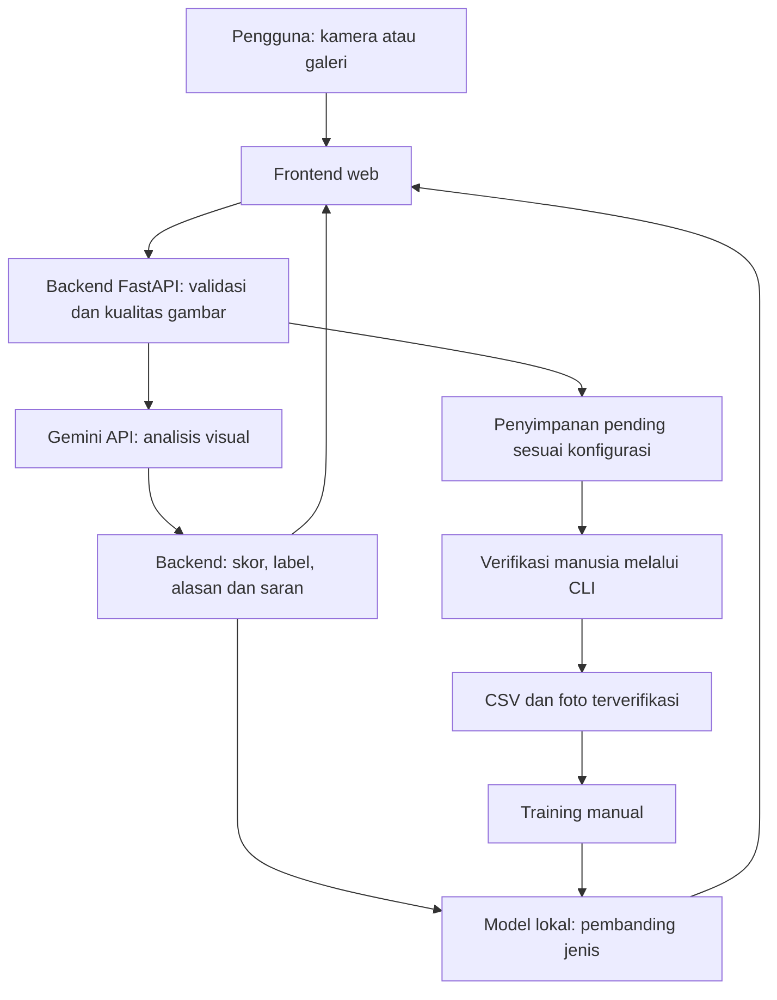
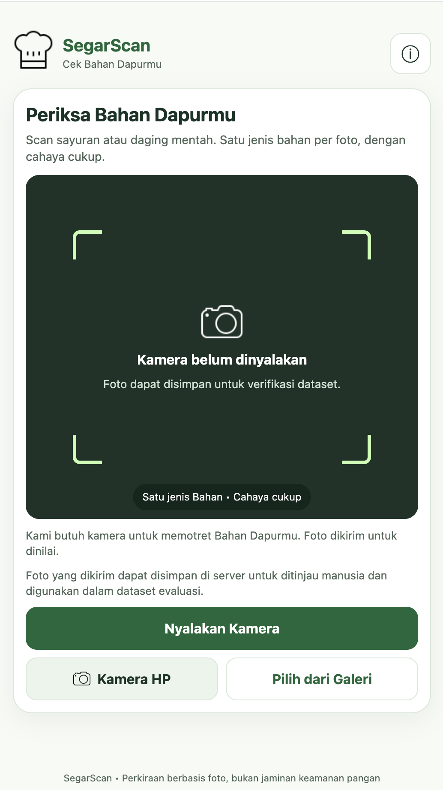
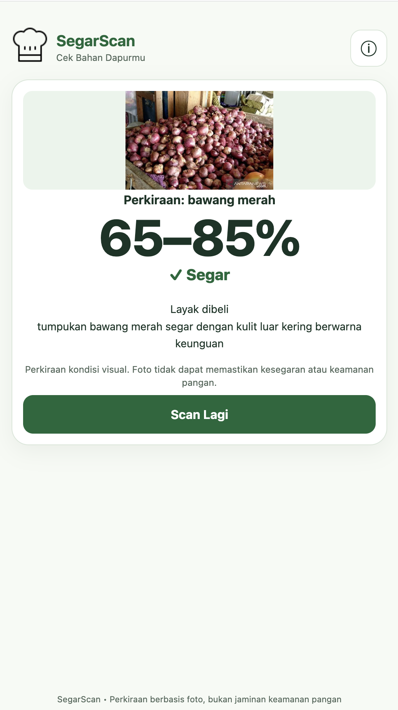
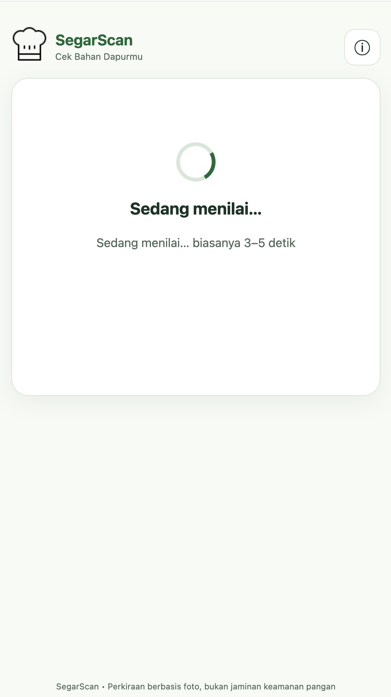
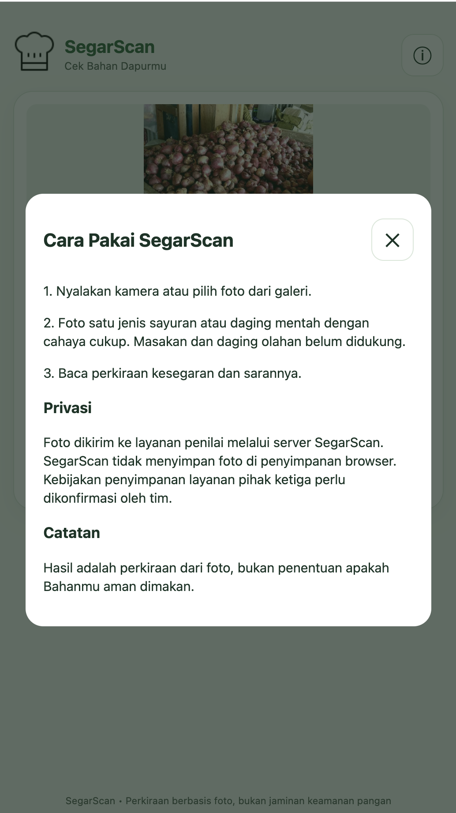
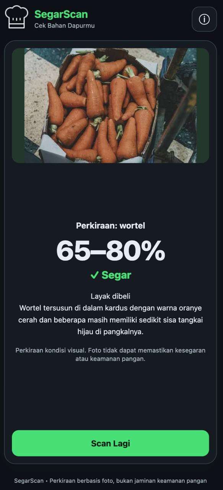
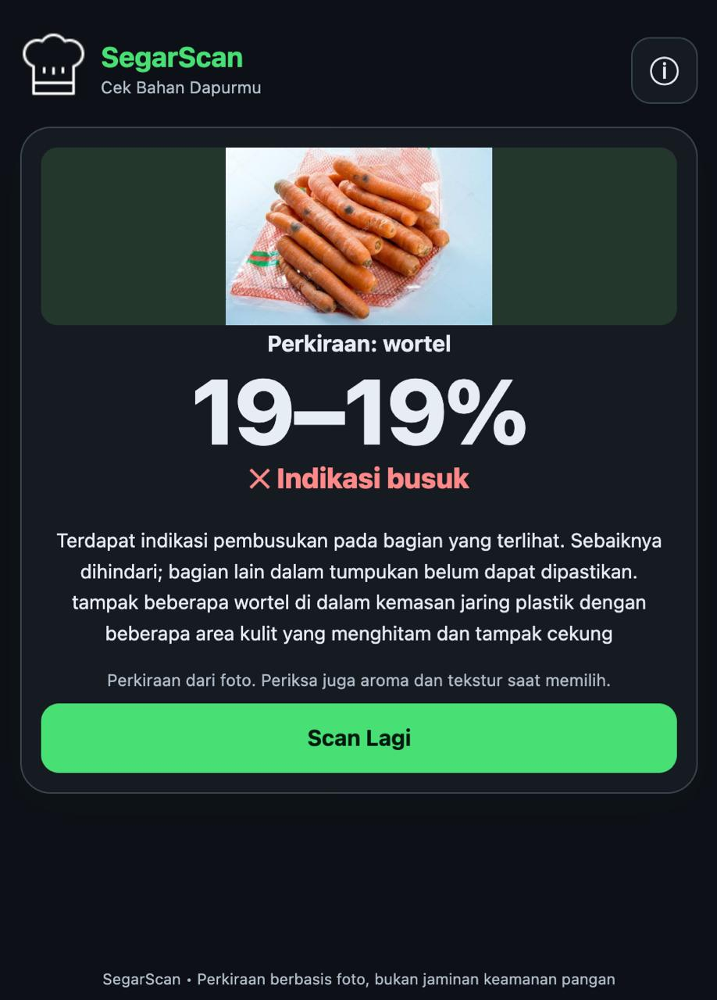
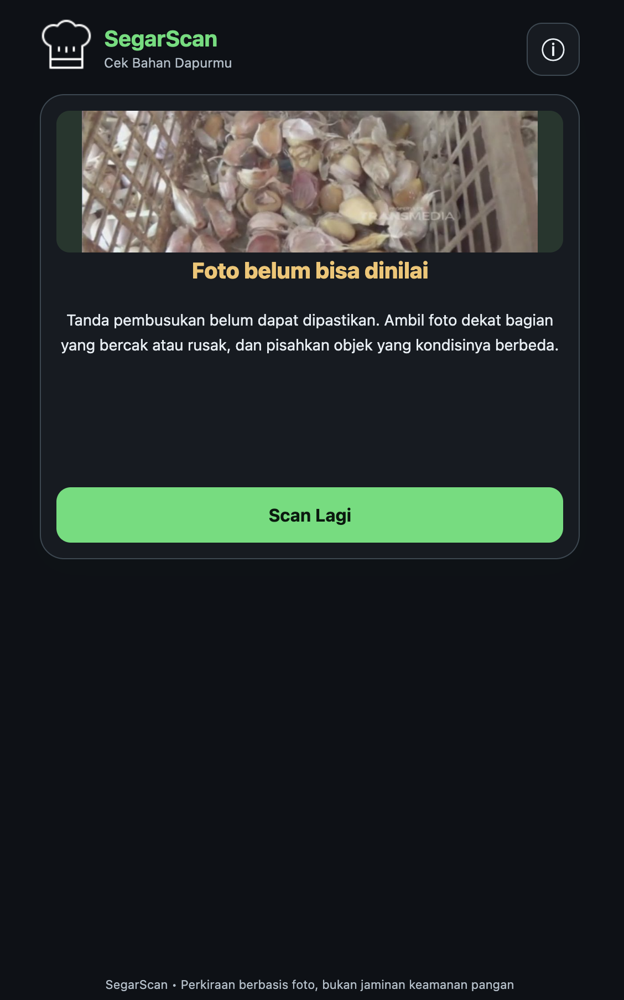

# SegarScan — Cek Bahan Dapurmu

## Description

SegarScan adalah aplikasi web yang membantu pengguna menilai kondisi visual sayuran dan daging mentah melalui foto. Google Gemini menganalisis jenis bahan dan tanda kerusakan yang terlihat, kemudian aplikasi menampilkan perkiraan kondisi, alasan, dan saran atau meminta foto ulang.

Dikembangkan oleh **Techdecinside** untuk AI Web Innovation Challenge, Bali DigiFest 2026. Hasil merupakan bantuan penilaian awal dan **tidak menjamin keamanan pangan**.

## Problem & Target User

Pembeli sering kesulitan mengenali tanda penurunan kesegaran bahan. Kesalahan memilih berpotensi menambah pengeluaran dan bahan yang terbuang.

Pengguna yang dituju adalah rumah tangga, mahasiswa, pembeli pemula, serta pelaku UMKM kuliner, termasuk di Bali. Mereka membutuhkan bantuan visual yang mudah digunakan lewat browser ponsel. Dampak terhadap pengurangan limbah dan biaya belum diukur melalui studi pengguna.

## Key Features

- Mengambil foto melalui kamera atau mengunggah gambar dari galeri.
- Memvalidasi gambar serta memeriksa kecerahan dan ketajaman sebelum analisis.
- Mengenali jenis sayuran atau daging mentah melalui Gemini.
- Menampilkan perkiraan kondisi visual, ciri yang terlihat, dan saran.
- Menampilkan indikasi pembusukan atau meminta foto ulang jika belum dapat dinilai.
- Memindai ulang dan menggunakan tampilan terang/gelap.
- Menampilkan prediksi jenis lokal sebagai pembanding eksperimental jika model tersedia.

Fitur pengelolaan dataset tersedia melalui CLI: penyimpanan pending sesuai konfigurasi, verifikasi manusia, dan retraining model jenis secara manual. Penyimpanan cloud memerlukan kredensial serta bucket/tabel yang sesuai.

## Tech Stack

| Bagian | Teknologi |
|---|---|
| Frontend | HTML, CSS, JavaScript; kamera browser dan unggah berkas |
| Backend | Python, FastAPI, Uvicorn |
| Analisis AI utama | Google Gemini API melalui Google GenAI SDK |
| Model lokal | Nearest-neighbor berbasis NumPy dan Pillow |
| Database / storage | Supabase Storage dan metadata PostgreSQL melalui PostgREST; opsi lokal dan Vercel Blob |
| Hosting | Vercel; konfigurasi layanan di `vercel.json` |
| Library pendukung | HTTPX, python-dotenv, SlowAPI, Pydantic |

## AI Implementation

### Input → proses → output

1. Pengguna mengirim foto satu jenis sayuran atau daging mentah.
2. Backend memvalidasi unggahan, memproses orientasi gambar, dan memeriksa kualitas foto.
3. Gemini menerima gambar serta prompt penilaian visual (`p5` pada kode saat dokumentasi ini disusun).
4. Backend mengolah respons menjadi jenis, skor/rentang, label, deskripsi ciri, serta saran. Bila pembusukan dilaporkan jelas, skor dibatasi hingga 19; bila meragukan, aplikasi menolak penilaian tanpa skor.
5. Frontend menampilkan hasil atau instruksi foto ulang. Foto dan metadata dapat disimpan sebagai pending sesuai konfigurasi.

AI relevan karena pengenalan jenis dan interpretasi ciri visual perlu menangani variasi warna, tekstur, sudut, dan kondisi bahan. Gemini menjadi bagian utama alur produk; aplikasi memerlukan akses API yang tersedia untuk melakukan penilaian.

### Model klasifikasi lokal

`ml/jenis.py` menggunakan nearest-neighbor dengan histogram warna, rata-rata warna spasial, dan tekstur tepi. Model hanya mengenali **jenis bahan**, bukan kesegaran, dan tidak menggantikan hasil Gemini.

Laporan `models/jenis.report.json` saat penyusunan README memuat **29 foto latih, 12 kelas, dan 0 foto uji**. Akurasi uji belum tersedia. Jarak hasil model bukan probabilitas atau confidence terkalibrasi.

## Architecture / Data Flow



Penyimpanan dataset merupakan jalur terpisah dari analisis AI. Foto pending belum otomatis menjadi data latih, dan verifikasi tidak otomatis menjalankan training.

## Installation / Run Instructions

Jalankan dari root repository pada macOS/Linux. Alur dataset memakai `fcntl`; untuk Windows gunakan lingkungan Linux seperti WSL.

```bash
python3 -m venv .venv
source .venv/bin/activate
python -m pip install 'fastapi>=0.111.0' 'uvicorn[standard]>=0.29.0' 'python-multipart>=0.0.9' 'pillow>=10.0.0' 'numpy>=1.26.0' 'python-dotenv>=1.0.0' 'google-genai>=1.0.0' 'httpx>=0.27.0' 'slowapi==0.1.10'
```

Perintah di atas memasang dependensi runtime yang dipakai backend. Saat README ini disusun, `requirements.txt` memiliki referensi rekursif `-r requirements.txt` dan mencampur dependensi training; berkas tersebut perlu dirapikan sebelum dijadikan acuan instalasi otomatis.

Buat `.env` di root proyek:

```dotenv
GEMINI_API_KEY=isi_kunci_sendiri
USE_VLM=1
USE_LOCAL_JENIS=1
DATASET_CAPTURE=1
STORAGE_BACKEND=local
```

Nama model Gemini dapat ditentukan melalui `GEMINI_MODEL` sesuai model yang tersedia pada akun. Simpan kredensial asli hanya di `.env` lokal atau environment variables hosting.

```bash
python -m uvicorn backend.app.main:app --reload
```

Buka [aplikasi lokal](http://127.0.0.1:8000/ui/), [dokumentasi API](http://127.0.0.1:8000/docs), atau [health endpoint](http://127.0.0.1:8000/health). Kamera pada perangkat pengguna memerlukan izin dan konteks browser yang mendukung, biasanya HTTPS atau localhost.

### Penyimpanan Supabase pada deployment

Isi environment variables server:

```dotenv
STORAGE_BACKEND=supabase
SUPABASE_URL=https://PROJECT_REF.supabase.co
SUPABASE_SECRET_KEY=isi_secret_server
SUPABASE_STORAGE_BUCKET=pending
SUPABASE_TABLE=pending_scans
DATASET_CAPTURE=1
```

Siapkan bucket `pending` dan tabel metadata menggunakan `scripts/supabase_schema.sql`. Gunakan backend eksplisit `local` atau `supabase`; nilai literal `auto` belum dinormalisasi oleh factory storage saat dokumentasi ini disusun. Variabel pada `.env` laptop perlu dimasukkan juga ke pengaturan hosting.

### Verifikasi dataset dan training lokal

```bash
python -m scripts.review_dataset list
python -m scripts.review_dataset verify ID_FOTO --jenis wortel --status ok --perangkat laptop --split dev
python -m scripts.train_jenis
```

Ganti `ID_FOTO` dengan ID foto yang benar-benar ditinjau. Status `ok` berarti foto dapat dinilai, bukan label segar. Split `dev` dipakai melatih model; siapkan foto terpisah pada split `test` untuk mengukur akurasi. Model tersimpan di `models/jenis.json` dan laporan di `models/jenis.report.json`.

## Deployment URL

**[Buka SegarScan](https://segarscan.vercel.app/)**

Repository: [dittprabawa/segar-scan](https://github.com/dittprabawa/segar-scan).

URL deployment diberikan oleh tim. Ketersediaan API, konfigurasi penyimpanan, dan fungsi scan harus diperiksa kembali sebelum penjurian. Catat commit hash atau tag submission yang sesuai dengan versi deployment pada formulir lomba.

## Demo Account

Alur scan tidak memerlukan akun pengguna. Juri dapat membuka website, memilih foto satu jenis bahan, menjalankan analisis, dan membaca hasilnya. Pengelolaan dataset dilakukan melalui CLI oleh pengelola proyek; tidak ada kredensial admin yang dicantumkan di README.

## Known Limitations

- Skor merupakan perkiraan kondisi visual, bukan persentase keamanan pangan atau hasil uji laboratorium.
- Aroma, bagian tertutup, kontaminasi, dan kondisi internal tidak dapat dipastikan dari foto.
- Mendukung sayuran dan daging mentah; masakan, daging olahan, serta campuran beberapa jenis belum menjadi cakupan MVP.
- Cahaya, keburaman, latar belakang, dan sudut foto dapat memengaruhi hasil.
- Respons bergantung pada jaringan, kuota, dan ketersediaan Gemini; model lokal bukan fallback kesegaran.
- Model lokal memiliki dataset kecil tanpa foto uji pada laporan saat ini. Kelas di luar data latih tetap dapat dipetakan ke kelas terdekat.
- Akurasi pengenalan jenis dan pembusukan pada foto lapangan belum tervalidasi.
- Foto dapat dikirim ke Gemini dan disimpan untuk verifikasi dataset. Pengguna perlu memahami alur ini sebelum mengunggah gambar.
- Konfigurasi dependensi root dan pemilihan storage `auto` masih memerlukan perbaikan sebagaimana dicatat pada petunjuk instalasi.

## Third-party Resources / Credits

- Google Gemini API dan Google GenAI SDK untuk analisis gambar.
- FastAPI, Uvicorn, NumPy, Pillow, HTTPX, python-dotenv, SlowAPI, dan Pydantic sebagai library utama.
- Supabase untuk penyimpanan cloud/metadata dan Vercel untuk hosting.
- Dataset lokal berasal dari foto yang dimasukkan melalui alur verifikasi manusia. Pelabelan manusia tidak otomatis membuktikan kepemilikan atau izin penggunaan gambar.
- Sebagian gambar demonstrasi berasal dari internet, termasuk gambar berwatermark **ANTARA News** dan **Transmedia**. Gambar tersebut bukan aset milik tim; sumber serta izin penggunaannya perlu dipastikan sebelum submission/publikasi.
- **OpenAI Codex** membantu coding, debugging, konfigurasi, dan dokumentasi. Tim tetap bertanggung jawab memahami serta memverifikasi implementasi.
- Penggunaan template/boilerplate dan aset pihak ketiga lain belum dikonfirmasi secara lengkap oleh tim; lengkapi disclosure jika ada.

## Team Members

**Nama tim: Techdecinside**

| Nama | Peran |
|---|---|
| I Ketut Aditya Juniantara | Ketua tim / Frontend Developer |
| I Made Adnyana Wiguna | Anggota / Backend Developer |
| I Putu Raditya Prabawa Suma Putra | Anggota / Backend Developer |

## AI & Technology Disclosure

| Komponen | Isi peserta |
|---|---|
| Nama Produk | SegarScan — Cek Bahan Dapurmu |
| Framework / Frontend | HTML, CSS, JavaScript |
| Backend / Runtime | Python, FastAPI, Uvicorn |
| Database / Storage | Supabase Storage dan PostgreSQL melalui PostgREST; penyimpanan lokal; adapter Vercel Blob tersedia |
| Hosting / Deployment | Vercel — https://segarscan.vercel.app/ |
| AI Model / API / Method | Google Gemini API; model jenis lokal nearest-neighbor berbasis fitur warna, spasial, dan tekstur |
| Peran AI dalam Produk | Foto → analisis jenis dan kondisi visual → perkiraan kondisi, alasan, saran, atau permintaan foto ulang |
| Dataset / Data Source | Foto melalui verifikasi manusia; 29 foto latih/12 kelas/0 foto uji dalam laporan lokal saat penyusunan README; sebagian gambar demo dari internet |
| Open-source Libraries | FastAPI, Uvicorn, NumPy, Pillow, HTTPX, python-dotenv, Google GenAI SDK, SlowAPI, Pydantic |
| Template / Boilerplate | Belum dikonfirmasi lengkap oleh tim; cantumkan sumber dan lisensi apabila digunakan |
| AI Coding Assistant | OpenAI Codex |
| Pre-existing Components | Fitur unggah foto dan analisis visual AI sudah dikembangkan sebelumnya. Perbaikan yang dibahas mencakup UI, kualitas foto, penanganan pembusukan, dan alur dataset/model lokal; pembagian lingkup sebelum dan selama lomba perlu dikonfirmasi tim |
| Third-party Assets / Credits | Sebagian gambar demo berwatermark ANTARA News dan Transmedia; bukan aset milik tim. Sumber serta hak penggunaan perlu dikonfirmasi |

API key dan kredensial tidak ditempatkan di frontend atau repository publik. File `.env` dikecualikan dari Git; `.env.example` hanya berisi contoh konfigurasi. Tim perlu memeriksa kembali kelengkapan disclosure dan hak penggunaan seluruh aset sebelum submission.

## Tampilan aplikasi

Berikut tampilan SegarScan pada iPhone dalam light theme dan dark theme, termasuk layar scan, proses penilaian, hasil, dan dialog informasi.

<table>
  <tr>
    <td align="center"><strong>Halaman scan</strong><br></td>
    <td align="center"><strong>Hasil penilaian</strong><br></td>
  </tr>
  <tr>
    <td align="center"><strong>Proses penilaian</strong><br></td>
    <td align="center"><strong>Dialog informasi</strong><br></td>
  </tr>
  <tr>
    <td colspan="2" align="center"><strong>Pratinjau tab Safari</strong><br></td>
  </tr>
</table>

### Light theme

<table>
  <tr>
    <td align="center"><strong>Halaman scan</strong><br></td>
    <td align="center"><strong>Hasil penilaian</strong><br></td>
  </tr>
  <tr>
    <td align="center"><strong>Proses penilaian</strong><br></td>
    <td align="center"><strong>Dialog informasi</strong><br></td>
  </tr>
</table>

## Contoh hasil penilaian

Berikut tiga contoh hasil aplikasi: bahan yang dinilai segar, bahan dengan indikasi pembusukan, dan foto yang belum bisa dinilai. Keterangan mengikuti hasil pada tangkapan layar, bukan label kebenaran untuk evaluasi model.

<table>
  <tr>
    <th>Segar</th>
    <th>Indikasi busuk</th>
    <th>Belum bisa dinilai</th>
  </tr>
  <tr>
    <td align="center" valign="top"></td>
    <td align="center" valign="top"></td>
    <td align="center" valign="top"></td>
  </tr>
</table>

| Contoh | Hasil yang ditampilkan | Penjelasan |
|---|---|---|
| Segar | Wortel, **65–80%**, label **Segar** | Aplikasi mendeskripsikan warna oranye cerah dan sisa tangkai hijau pada sebagian wortel. |
| Kondisi kurang baik | Wortel, **19–19%**, label **Indikasi busuk** | Aplikasi melaporkan area kulit menghitam dan tampak cekung. Skor dibatasi hingga 19 saat indikasi pembusukan dinilai jelas. |
| Tidak bisa dinilai | **Foto belum bisa dinilai**, tanpa skor | Tanda pembusukan belum dapat dipastikan. Aplikasi meminta foto lebih dekat pada bagian bercak atau rusak, serta pemisahan objek yang kondisinya berbeda. |

Angka persentase pada tampilan merupakan rentang perkiraan visual aplikasi, bukan persentase keamanan pangan. Status **belum bisa dinilai** berarti informasi visual belum cukup untuk memberikan penilaian; status ini tidak otomatis berarti bahan busuk atau jenisnya tidak dikenali.


## Dokumentasi tambahan

[Arsip dokumentasi sebelumnya](docs/README-sebelumnya.md) tersedia sebagai referensi historis. README ini menjadi acuan utama struktur submission.
